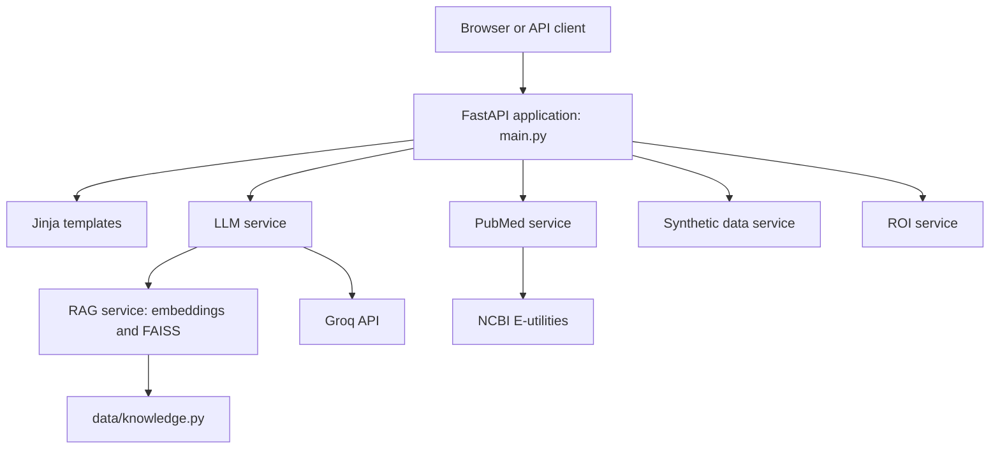

# Conference Intelligence

Conference Intelligence is a FastAPI application for searching and ranking conference abstracts, generating synthetic conference data, and analyzing uploaded documents or media with an LLM.

## Architecture

### Components

- `main.py` creates the FastAPI app, defines API and page routes, handles document and media extraction, and coordinates the services.
- `app/main.py` re-exports the FastAPI app for compatibility with the `app.main` import path.
- `services/pubmed_service.py` searches PubMed and retrieves abstract records from NCBI E-utilities.
- `services/llm_service.py` ranks abstracts, creates summaries, analyzes extracted content, and transcribes media through Groq-backed operations.
- `services/rag_service.py` embeds the knowledge base and retrieves relevant context with a FAISS index.
- `services/synthetic_service.py` generates synthetic abstracts and conference agenda data.
- `services/roi_service.py` calculates conference and LLM cost estimates.
- `data/knowledge.py` contains the retrieval knowledge base and mock archive records.
- `templates/` contains the Jinja dashboard and workspace pages rendered by FastAPI.
- `config.py` loads the Groq API key and model configuration from environment variables.

## Request Flow

1. A browser or API client sends a request to the FastAPI application.
2. The route validates input and invokes the relevant service.
3. The service uses local knowledge or calls an external provider such as PubMed or Groq.
4. The application returns JSON or renders a Jinja template.

The RAG index is initialized from `data/knowledge.py` when the LLM service loads. Uploaded files are processed per request; the bundled `data/documents/` directory is not required by the application code.